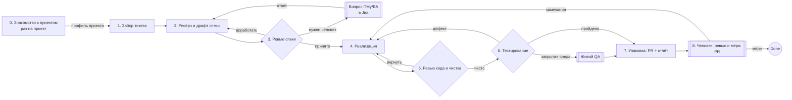

# 02 — Целевой воркфлоу: путь тикета

Пометки: **✓ ADAPT** — этап реально работал на ADAPT (вручную, по отдельным
сессиям); **◇ новое** — этапа на ADAPT не было, это предложение.

## Схема

Двойная рамка — человек. Всё остальное — агенты. Тикет между этапами ведёт
диспетчер — Opus-агент (D19). Любая петля возврата (3 → 2, 5 → 4, 6 → 4)
проходится не больше двух раз; третий возврат — эскалация человеку (D21).
Любое изменение кода, в том числе после возврата, снова проходит ревью кода
(только дельта) и тест (D20).

## Этапы

### 0. Знакомство с проектом — ◇ новое, раз на проект

**Зачем.** Фреймворк не знает стек и домен (D3). Прежде чем брать тикеты,
система собирает **профиль проекта**: что это за продукт, из каких частей
состоит, как собрать, как проверить, какие среды доступны агентам, какие
правила у клиента, кто за что отвечает.

**Кто.** Агент-аналитик проекта (сильная модель, высокое усилие).

**Как.** Читает репозитории, трекер и всю документацию проекта — Confluence,
Drive, Notion и т. п., доступ полный (D35). Чего нет в документах — спрашивает у человека в формате
короткой QA-сессии. Пишет `PROJECT-PROFILE.md`, `CLAUDE.md` проекта и
заготовки журналов (`04-knowledge-layer.md`). Профиль обновляется, когда
проект меняется, а не на каждый тикет.

**Запись в документацию** — для всех агентов, не только аналитика: читать
можно всё, писать — только в свои страницы и техзаметки (раздел / папка из
профиля). Бизнес- и ПМ-документацию агенты не трогают (D36).

**Результат.** Профиль проекта: матрица проверок (какой командой проверяется
каждый слой), доступные среды, правила тестирования, роли и владельцы,
источники правды и их приоритет.

### 1. Забор тикета — ◇ новое (на ADAPT — владелец вручную)

**Кто.** Диспетчер (оркестратор конвейера) — Opus-агент (D19). Ведёт тикет
до PR: решает, кого звать дальше, пишет брифы, маршрутизирует по вердиктам
агентов. Сам не пишет ни код, ни спецификации: его инструменты — запуск
агентов, трекер и git-упаковка. Этапы не пропускает: для простого тикета
снижает усилие агентов; сокращённый путь — только по правилу из профиля
проекта (D23).

**Как.** Маркеров «взять в работу» нет (D28): диспетчер сам выбирает тикеты
из пула и решает, в какой очередности их вести, можно ли параллельно и важен
ли порядок — по связям тикетов («блокирует / заблокирован»), порядку в эпике,
приоритету и пересечению по коду. **Пул** — тикеты текущего спринта в статусе
«К работе», назначенные на разработчика, от чьего имени работает агент (D32):
ПМ управляет пулом обычным назначением исполнителя. Одновременно — не больше
тикетов, чем потолок из профиля (на пилоте 2, D33). **Запуск** — человек
запускает диспетчера одной командой; тот работает, пока пул не опустеет или
все оставшиеся тикеты не будут ждать ответа; расписаний нет (D32). Взяв тикет,
ставит статус «Ресёрч» и пишет в тикет комментарий «взят в работу». В трекере
и git работает от имени разработчика (D27); действия агента ничем не
помечаются (D31).

**Если описания нет** — не угадывает и не эскалирует сразу: этап 2
восстанавливает скоуп из эпика, соседних тикетов и кода, восстановленное
помечает в спеке как допущение. Эскалация — только если на этапах 2–3
возникает блокер, который снимает только человек (D29).

### 2. Ресёрч и драфт спецификации — ✓ ADAPT (`/draft-ticket`)

**Кто.** Агент-исследователь (сильная модель, высокое усилие).

**Читает.** Тикет и его эпик, соседние тикеты эпика (они определяют, чего
здесь *не* делать), журнал находок (нет ли уже записанного долга на этот
тикет), профиль проекта, код.

**Пишет.** `tickets/<KEY>.md` со статусом `DRAFT`: что входит, что явно не
входит (со ссылкой на соседний тикет), проверяемые критерии приёмки,
технические заметки «что уже есть в коде», открытые вопросы. Всё, в чём он не
уверен, идёт в открытые вопросы, а не в критерии.

### 3. Ревью спецификации — ✓ ADAPT (вторая сессия + владелец ставил `CONFIRMED`)

**Кто.** Агент-ревьюер — **другой** агент, сильная модель, высокое усилие.

**Как.** Сверяет спецификацию с кодом: каждое утверждение драфта — гипотеза,
которую надо подтвердить файлом и строкой или запуском. На ADAPT этот приём не
раз ловил настоящие ошибки драфта.

Отдельно проверяет, что **каждый критерий приёмки проверяем** и в спеке
указано, чем его проверить (команда, сценарий, эталонное значение). Так
тестировщик на этапе 6 получает готовый список проверок, а разработчик
заранее знает, по чему его примут (D20).

**Исходы:**
- **Принято** → `Status: CONFIRMED`, Jira «В разработке».
- **Доработать** → обратно на этап 2 с замечаниями; не больше двух раз,
  затем эскалация (D21).
- **Нужен человек** → открытые вопросы, которые не снимаются кодом и
  документацией, уходят комментарием в Jira с упоминанием адресата по типу
  вопроса (требования → ПМ/BA, техника → тимлид, среды → DevOps; иначе ПМ —
  D22); тикет в статусе «Нужна информация»; после ответа — снова этап 2.

### 4. Реализация — ✓ ADAPT (`/work-ticket`)

**Кто.** Агент-разработчик (быстрая модель; усилие — по сложности тикета).

**Как.**
1. Пересказывает скоуп: что трогает, что сознательно не трогает.
2. Загружает правила проекта и нужные скиллы.
3. Реализует строго в пределах критериев приёмки.
4. Всё замеченное вне скоупа классифицирует: **блокирующее** (без этого тикет
   не сделать — минимальная правка + запись) или **неблокирующее** (только
   запись). По умолчанию — неблокирующее.
5. Каждую находку записывает в журнал с владельцем (разработчик / ML / QA /
   DevOps / BA / PM…); своя работа без тикета — ещё и в бэклог.
6. Пишет юнит-тесты на свой код и проверяет себя **экономно**: тесты
   затронутых мест, полный прогон один раз в конце. Исчерпывающая проверка —
   работа тестировщика.
7. Пишет отчёт: что сделано по каждому критерию, чем проверено, какие находки.

Работает в своей ветке / изолированной копии, чтобы параллельные тикеты не
правили одно дерево. По умолчанию — ветка и PR на тикет; если у клиента
другой git-процесс, он записан в профиле и главнее умолчания (D25).

### 5. Ревью кода и чистка — ◇ новое

**Кто.** Агент-ревьюер кода (сильная модель, среднее усилие). Одна роль —
ревьюер и чистильщик (D20).

**Почему до тестирования.** Тестировщик должен проверять ровно тот код,
который уйдёт в PR. Если чистить после теста, правки чистильщика попадают в PR
непротестированными. К тому же дешёвая проверка по диффу ловит часть проблем
раньше дорогого прогона (D20).

**Как.** Смотрит дифф, а не отчёт:
- дифф трогает только то, что заявлено в скоупе;
- код в стиле окружающего кода, без новых паттернов «из головы»;
- нет отладочного кода, лишних и «журнальных» комментариев, ключей тикетов в
  комментариях, мёртвого кода;
- нет запрещённых приёмов из правил проекта (выдуманные значения вместо
  отсутствующих данных, проглоченные ошибки, скрытые ретраи);
- утверждения отчёта совпадают с диффом.

**Исходы:** косметику правит сам, не меняя поведения, и перезапускает
затронутые тесты → этап 6; всё, что меняет поведение, — обратно на этап 4 со
списком замечаний (не больше двух раз, D21).

### 6. Тестирование — ◇ новое (на ADAPT — живой QA + перепроверка отчёта)

**Кто.** Агент-тестировщик (быстрая модель; независим от разработчика).

**Как.** Тестирует финальный код — после ревью и чистки — всё, что может (D6):
- проверяет каждый критерий приёмки отдельно, по реальному запуску, а не по
  чтению кода, — по способам проверки, записанным в спеке на этапе 3;
- повторяет исходное воспроизведение, если тикет — баг;
- прогоняет матрицу проверок из профиля проекта и регрессионный набор
  (на ADAPT — golden-датасет);
- пересчитывает хотя бы одно эталонное значение независимым способом;
- проверяет соседние сценарии на регрессию.

Может писать и чинить тесты (приёмочные, регрессионные); продуктовый код не
правит.

**Закрытая среда.** Если профиль проекта говорит, что часть проверки возможна
только там, куда агентам нет доступа, тестировщик пишет план ручной проверки в
тикет и переводит его в «Готов к QA» — эту часть делает живой QA, потом
конвейер продолжается.

**Исходы:** дефект → обратно на этап 4 с воспроизведением (не больше двух
раз, D21); исправление снова проходит этап 5 (только дельта) и этап 6;
пройдено → этап 7.

### 7. Упаковка: PR и отчёт — ◇ новое (на ADAPT git и Jira вёл владелец)

**Кто.** Диспетчер.

**Как.** Коммит в ветку тикета, pull request с описанием: что сделано по
каждому критерию, чем проверено, какие находки записаны и кому, что передано
QA. Ссылка на PR — в тикет, статус «Ревью PR». Спецификация и отчёт — в
архив тикетов. Обновляет `HANDOFF.md` проекта.

### 8. Ревью и мёрж PR — человек

Единственный обязательный человеческий шаг (D4). Замечания в PR агент
разбирает сам (D34): диспетчер передаёт их разработчику-агенту как бриф,
правки проходят этапы 5 и 6 (дельта) и пушатся в тот же PR; на каждый
комментарий — ответ в PR, что сделано; несогласие или вопрос — ответом в PR.
Лимит возвратов на эту петлю не действует — её ведёт человек. Что после мёржа — поле
профиля (D30): по умолчанию «Готово»; если на проекте есть QA на стенде —
«Ждёт QA на стенде», и «Готово» ставит QA. Дефект после мёржа — новый баг со
ссылкой, смёрженный тикет конвейер не переоткрывает.

## Сквозные механизмы

| Механизм | Что это | Откуда |
|---|---|---|
| Журнал находок | Всё, что найдено и сознательно не исправлено: где, что, владелец, приоритет, решено ли | ✓ ADAPT |
| Маршрутизация по владельцу | Каждая находка получает владельца-роль; своя работа без тикета — в бэклог, чужая — в журнал владельца | ✓ ADAPT |
| Реестр расхождений со спекой | Где спецификация клиента расходится с данными/кодом — уходит клиенту через ПМа | ✓ ADAPT |
| Журнал решений | Все решения и допущения с датой — чтобы следующий агент не переоткрывал их | ✓ ADAPT |
| HANDOFF проекта | Карта текущего состояния для каждого нового агента | ✓ ADAPT |
| Эскалация | Вопрос в Jira с упоминанием адресата по типу вопроса (по словарю ролей профиля; иначе ПМ), статус «Нужна информация», тикет на паузе (D22). Ожидающий тикет не занимает очередь, ветка сохраняется; без ответа N рабочих дней (профиль, по умолчанию 2) — одно напоминание с упоминанием ПМа (D24) | ◇ новое как автоматика; на ADAPT — вопросы в чате владельцу |
| Лимит возвратов | Каждая петля (3 → 2, 5 → 4, 6 → 4) — не больше двух возвратов; третий — эскалация. Поле профиля, по умолчанию 2 (D21) | ◇ новое |

## Статусы в трекере (предложение)

В трекер пишет только диспетчер (D19), от имени разработчика (D27); колонка
«по чьему вердикту» говорит, какой агент дал основание для перехода.

| Статус | Ставит | По чьему вердикту | Этап |
|---|---|---|---|
| К работе | человек | — | пул, из которого диспетчер выбирает тикеты (1) |
| Ресёрч | диспетчер | — | 2 |
| Ревью спеки | диспетчер | исследователь (драфт готов) | 3 |
| Нужна информация | диспетчер | любой агент (эскалация) | эскалация |
| В разработке | диспетчер | ревьюер спеки (принято) | 4 |
| Ревью кода | диспетчер | разработчик (отчёт готов) | 5 |
| Тестирование | диспетчер | ревьюер кода (чисто) | 6 |
| Готов к QA | диспетчер | тестировщик (закрытая среда) | закрытая среда |
| Ревью PR | диспетчер | тестировщик (пройдено) / QA | 8 |
| Ждёт QA на стенде | диспетчер | человек (мёрж), если в профиле есть QA на стенде | после мёржа |
| Готово | человек (мёрж) или QA на стенде | — | — |

Конкретные названия статусов — под workflow трекера каждого проекта; в
профиле проекта хранится соответствие «этап → статус».

## Что изменилось относительно ADAPT

| На ADAPT | В целевой картине |
|---|---|
| Владелец сам запускал каждую команду в отдельной сессии | Диспетчер передаёт тикет между агентами |
| Владелец читал драфт и ставил `CONFIRMED` | Агент-ревьюер спеки; человек — только по эскалации |
| Владелец проверял отчёт воркера | Тестировщик + ревьюер кода |
| Владелец вёл git и статусы Jira | Диспетчер: ветка, PR, статусы, комментарии |
| Специфика проекта жила в `CLAUDE.md`, написанном вручную | Профиль проекта собирается этапом 0 |
| Тестировщика-агента и чистки не было | Отдельные этапы: 5 — ревью кода и чистка, 6 — тестирование финального кода |
