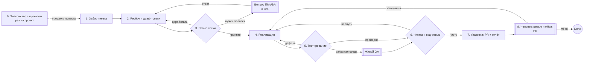

# 02 — Целевой воркфлоу: путь тикета

Пометки: **✓ ADAPT** — этап реально работал на ADAPT (вручную, по отдельным
сессиям); **◇ новое** — этапа на ADAPT не было, это предложение.

## Схема

Двойная рамка — человек. Всё остальное — агенты.

## Этапы

### 0. Знакомство с проектом — ◇ новое, раз на проект

**Зачем.** Фреймворк не знает стек и домен (D3). Прежде чем брать тикеты,
система собирает **профиль проекта**: что это за продукт, из каких частей
состоит, как собрать, как проверить, какие среды доступны агентам, какие
правила у клиента, кто за что отвечает.

**Кто.** Агент-аналитик проекта (сильная модель, высокое усилие).

**Как.** Читает репозитории, документацию, PM/BA-материалы (в будущем — с
полным доступом, D3). Чего нет в документах — спрашивает у человека в формате
короткой QA-сессии. Пишет `PROJECT-PROFILE.md`, `CLAUDE.md` проекта и
заготовки журналов (`04-knowledge-layer.md`). Профиль обновляется, когда
проект меняется, а не на каждый тикет.

**Результат.** Профиль проекта: матрица проверок (какой командой проверяется
каждый слой), доступные среды, правила тестирования, роли и владельцы,
источники правды и их приоритет.

### 1. Забор тикета — ◇ новое (на ADAPT — владелец вручную)

**Кто.** Диспетчер (оркестратор конвейера).

**Как.** Запускается триггером (D8: скорее всего человек переводит тикет в
статус «В очередь AI» или ставит метку; возможна реакция на создание тикета).
Проверяет, что у тикета есть описание и что он не заблокирован, ставит
статус «Ресёрч», пишет в тикет комментарий «взят в работу».

**Если описания нет** — не угадывает: этап 2 восстанавливает скоуп из эпика и
соседних тикетов, а недостающее уходит вопросом через этап 3.

### 2. Ресёрч и драфт спецификации — ✓ ADAPT (`/draft-ticket`)

**Кто.** Агент-исследователь (сильная модель, высокое усилие).

**Читает.** Тикет и его эпик, соседние тикеты эпика (они определяют, чего
здесь *не* делать), журнал находок (нет ли уже записанного долга на этот
тикет), профиль проекта, код.

**Пишет.** `tickets/<KEY>.md` со статусом `DRAFT`: что входит, что явно не
входит (со ссылкой на соседний тикет), проверяемые критерии приёмки,
технические заметки «что уже есть в коде», открытые вопросы. Всё, в чём он не
уверен, идёт в открытые вопросы, а не в критерии.

### 3. Ревью спецификации — ✓ ADAPT (вторая сессия + владелец ставил `CONFIRMED`)

**Кто.** Агент-ревьюер — **другой** агент, сильная модель, высокое усилие.

**Как.** Сверяет спецификацию с кодом: каждое утверждение драфта — гипотеза,
которую надо подтвердить файлом и строкой или запуском. На ADAPT этот приём не
раз ловил настоящие ошибки драфта.

**Исходы:**
- **Принято** → `Status: CONFIRMED`, Jira «В разработке».
- **Доработать** → обратно на этап 2 с замечаниями (лимит возвратов, затем
  эскалация).
- **Нужен человек** → открытые вопросы, которые не снимаются кодом и
  документацией, уходят комментарием ПМу/BA в Jira; тикет в статусе «Нужна
  информация»; после ответа — снова этап 2.

### 4. Реализация — ✓ ADAPT (`/work-ticket`)

**Кто.** Агент-разработчик (быстрая модель; усилие — по сложности тикета).

**Как.**
1. Пересказывает скоуп: что трогает, что сознательно не трогает.
2. Загружает правила проекта и нужные скиллы.
3. Реализует строго в пределах критериев приёмки.
4. Всё замеченное вне скоупа классифицирует: **блокирующее** (без этого тикет
   не сделать — минимальная правка + запись) или **неблокирующее** (только
   запись). По умолчанию — неблокирующее.
5. Каждую находку записывает в журнал с владельцем (разработчик / ML / QA /
   DevOps / BA / PM…); своя работа без тикета — ещё и в бэклог.
6. Проверяет себя **экономно**: тесты затронутых мест, полный прогон один раз
   в конце. Исчерпывающая проверка — работа тестировщика.
7. Пишет отчёт: что сделано по каждому критерию, чем проверено, какие находки.

Работает в своей ветке / изолированной копии, чтобы параллельные тикеты не
правили одно дерево.

### 5. Тестирование — ◇ новое (на ADAPT — живой QA + перепроверка отчёта)

**Кто.** Агент-тестировщик (быстрая модель; независим от разработчика).

**Как.** Тестирует всё, что может (D6):
- проверяет каждый критерий приёмки отдельно, по реальному запуску, а не по
  чтению кода;
- повторяет исходное воспроизведение, если тикет — баг;
- прогоняет матрицу проверок из профиля проекта и регрессионный набор
  (на ADAPT — golden-датасет);
- пересчитывает хотя бы одно эталонное значение независимым способом;
- проверяет соседние сценарии на регрессию.

**Закрытая среда.** Если профиль проекта говорит, что часть проверки возможна
только там, куда агентам нет доступа, тестировщик пишет план ручной проверки в
тикет и переводит его в «Готов к QA» — эту часть делает живой QA, потом
конвейер продолжается.

**Исходы:** дефект → обратно на этап 4 с воспроизведением; пройдено → этап 6.

### 6. Чистка и код-ревью — ◇ новое

**Кто.** Агент-ревьюер кода (сильная модель, среднее усилие).

**Как.** Смотрит дифф, а не отчёт:
- дифф трогает только то, что заявлено в скоупе;
- код в стиле окружающего кода, без новых паттернов «из головы»;
- нет отладочного кода, лишних и «журнальных» комментариев, ключей тикетов в
  комментариях, мёртвого кода;
- нет запрещённых приёмов из правил проекта (выдуманные значения вместо
  отсутствующих данных, проглоченные ошибки, скрытые ретраи);
- утверждения отчёта совпадают с диффом.

Мелкое чистит сам; существенное возвращает на этап 4.

### 7. Упаковка: PR и отчёт — ◇ новое (на ADAPT git и Jira вёл владелец)

**Кто.** Диспетчер.

**Как.** Коммит в ветку тикета, pull request с описанием: что сделано по
каждому критерию, чем проверено, какие находки записаны и кому, что передано
QA. Ссылка на PR — в тикет, статус «Ревью PR». Спецификация и отчёт — в
архив тикетов. Обновляет `HANDOFF.md` проекта.

### 8. Ревью и мёрж PR — человек

Единственный обязательный человеческий шаг (D4). Замечания в PR возвращают
тикет на этап 4 — агент разбирает комментарии ревью. Мёрж → «Done» в Jira.

## Сквозные механизмы

| Механизм | Что это | Откуда |
|---|---|---|
| Журнал находок | Всё, что найдено и сознательно не исправлено: где, что, владелец, приоритет, решено ли | ✓ ADAPT |
| Маршрутизация по владельцу | Каждая находка получает владельца-роль; своя работа без тикета — в бэклог, чужая — в журнал владельца | ✓ ADAPT |
| Реестр расхождений со спекой | Где спецификация клиента расходится с данными/кодом — уходит клиенту через ПМа | ✓ ADAPT |
| Журнал решений | Все решения и допущения с датой — чтобы следующий агент не переоткрывал их | ✓ ADAPT |
| HANDOFF проекта | Карта текущего состояния для каждого нового агента | ✓ ADAPT |
| Эскалация | Вопрос человеку через трекер, тикет на паузе | ◇ новое как автоматика; на ADAPT — вопросы в чате владельцу |
| Лимит возвратов | После N возвратов между этапами — эскалация, а не бесконечный цикл | ◇ новое |

## Статусы в трекере (предложение)

| Статус | Кто ставит | Этап |
|---|---|---|
| К работе | человек | — |
| В очередь AI | человек (триггер) | 1 |
| Ресёрч | диспетчер | 2 |
| Ревью спеки | исследователь | 3 |
| Нужна информация | ревьюер спеки | эскалация |
| В разработке | ревьюер спеки | 4 |
| Тестирование | разработчик | 5 |
| Готов к QA | тестировщик | закрытая среда |
| Чистка | тестировщик | 6 |
| Ревью PR | диспетчер | 8 |
| Готово | человек (мёрж) | — |

Конкретные названия статусов — под workflow трекера каждого проекта; в
профиле проекта хранится соответствие «этап → статус».

## Что изменилось относительно ADAPT

| На ADAPT | В целевой картине |
|---|---|
| Владелец сам запускал каждую команду в отдельной сессии | Диспетчер передаёт тикет между агентами |
| Владелец читал драфт и ставил `CONFIRMED` | Агент-ревьюер спеки; человек — только по эскалации |
| Владелец проверял отчёт воркера | Тестировщик + ревьюер кода |
| Владелец вёл git и статусы Jira | Диспетчер: ветка, PR, статусы, комментарии |
| Специфика проекта жила в `CLAUDE.md`, написанном вручную | Профиль проекта собирается этапом 0 |
| Тестировщика-агента и чистки не было | Отдельные этапы 5 и 6 |
