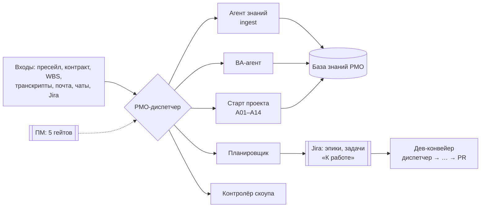

# 09 — PMO-часть: от пресейла до готовых тикетов

Дев-конвейер (`02-target-workflow.md`) начинается с готового тикета в Jira.
Этот документ описывает, откуда тикеты берутся: как агенты ведут старт проекта
(day zero), собирают и обрабатывают знания о проекте и превращают скоуп в
задачи, которые дев-конвейер забирает сам (D32). Решения — D39–D50.

Пометки: **✓ PMO** — механизм уже есть у PMO-отдела (инструмент или регламент
в `PMO-docs/`); **◇ новое** — предложение этого проекта.

## Источники

| Источник (`PMO-docs/`) | Что это | Что берём |
|---|---|---|
| `A. Project Initiation, Planning, and Kick-off.md` | Регламент Standard A: шаги A01–A14 от передачи из пресейла до kick-off | Шаги day zero и гейт A09 |
| `pmo-accelerator-main` (PM Copilot) | Плагин Claude для ПМа, 21 скилл: по шагу на A01–A14, реестр рисков, статус проекта, дайджест | Контракт шагов (входы, обязательные выходы, критерии, эскалации), 23 обязательных артефакта старта, роутер «что уже есть → самый слабый шаг», запись во внешние системы только после подтверждения |
| `optimum-kb-main` | База знаний реального проекта: git + Obsidian, инструкции для агентов | Неизменяемые источники, типизированные заметки, двухфазный ingest, lint, фильтр денег и персональных данных, журнал, генерируемый индекс |
| `Capability_Driven_AI_Delivery_Methodology_RU.docx` | Методология: обязательства → capabilities → контекст → план → инкременты → спеки → задачи | Доменная модель и прослеживаемость до контракта; агент читает не всю базу, а связанный кусок |
| `Spec Framework v2` | BA-фреймворк: Platform Spec → эпики → фичи | Бинарные критерии Given/When/Then, вопросы P0/P1/P2, журнал решений, Definition of Ready |

Названия клиентов, ID страниц Confluence, поля PROREP, структура P&L — внутреннее
для компании и конкретных проектов, во фреймворк не переносится (D3, D42).

## Как сейчас (as-is)

- **Старт проекта** идёт по Standard A: ПМ проходит A01–A14, PM Copilot готовит
  черновики и проверяет; решает и отправляет ПМ. ✓ PMO
- **Знания** на одном проекте собираются в базу по образцу `optimum-kb`:
  источник → таблица предложенных изменений → человек одобряет → заметка. ✓ PMO
- **Спецификации** BA пишет по Spec Framework: Platform Spec, эпики, фичи. ✓ PMO
- **Задачи в Jira не создаёт ни один инструмент.** PM Copilot пишет только
  статус проекта и риски; Spec Framework отдаёт разработке файлы эпиков; в
  `optimum-kb` связь с Jira только запланирована. Мост «инкремент → тикет →
  разработка» отсутствует — его и строит наша система. ◇ новое

## Целевая картина



Слева направо: входящая информация → база знаний PMO → план и задачи в Jira →
дев-конвейер. Человек — ПМ (и при наличии BA, тимлид, клиент) на пяти гейтах
(D41).

## Модель знаний

По методологии Capability-Driven, хранение — по механике `optimum-kb`.

```
Обязательства (контракт, SOW, WBS, NFR)            ← «на каком основании»
        ↓ обосновывают
Capability (возможность продукта; business / enabler)   ← центр
        ↑ уточняют: требования, решения, вопросы, ограничения
        ↑ угрожают: риски
        ↓ реализуют
Инкремент (результат текущей итерации, может задевать несколько capabilities)
        ↓ раскладывается
Задачи (по репозиториям / исполнителям) → тикеты Jira → дев-конвейер
```

- **Типы заметок:** capability, требование, решение, вопрос, ограничение,
  обязательство, риск, термин, инкремент. У каждой — статус (черновик →
  предложено → подтверждено → устарело), источник с цитатой, кто написал и кто
  подтвердил. ✓ PMO
- **Источники неизменяемы**, заметки ссылаются на них. ✓ PMO
- **Требование без основания в обязательствах** — кандидат на change request;
  решение по нему — гейт D41-3. ✓ PMO
- **Состояние задач** (статус, исполнитель, оценка) живёт только в Jira, не в
  заметках. ✓ PMO
- **Дев-агенты** берут из базы PMO только подграф тикета: инкремент → его
  capabilities → их требования, решения, ограничения. Пишут свои технические
  заметки у себя в дев-проекте (D36, D43). ◇ новое
- **Где физически лежит база** — поле профиля проекта (D49).

## Агенты PMO — ◇ новое (предложение)

Та же схема, что в дев-части: супервизор и узкие роли; бриф → вердикт.

| Роль | Делает | Модель |
|---|---|---|
| PMO-диспетчер | Принимает входящее, решает, кого звать, ведёт гейты, держит связь с дев-диспетчером | Opus |
| Агент старта проекта | Day zero: A01–A07, A11, A13 (D44) | Opus · high |
| Агент знаний | Ingest: источник → проверка (деньги, персональные данные, секреты) → предложенные изменения → запись рутины сам, решения и скоуп — ПМу (D47) | Sonnet · high |
| BA-агент | Вопросы к воркшопам, разбор транскриптов, требования и критерии приёмки, кандидаты на change request (D45) | Opus · high |
| Планировщик | План capabilities по итерациям, инкременты, сквозная спека, задачи, проверка Definition of Ready, создание эпиков и задач в Jira (D40) | Opus · high |
| Контролёр скоупа | План-факт по capabilities, реестр кандидатов на change request, противоречия и устаревание в базе, ревизия рисков | Sonnet · medium |

## Day zero (A01–A14) — D44

| Шаг | Кто | Результат |
|---|---|---|
| A01 Передача из пресейла | агент | проблема клиента, допущения, обязательства, первые риски, оценка полноты передачи |
| A02 Стейкхолдеры, роли | агент | реестр стейкхолдеров, кто что решает |
| A03 Контракт | агент | реестр обязательств; сверка «в контракте / в плане» |
| A04 Описание проекта | агент | описание: проблема, цели, ограничения |
| A05 Скоуп и оценки | агент | нормализация WBS в capabilities со ссылками на обязательства; пропущенные категории работ |
| A06 Риски | агент | реестр рисков, зависимостей, пробелов |
| A07 Roadmap | агент | план capabilities по итерациям, вехи |
| A08 Экономика | **человек** | агент готовит данные; деньги не считает (D5) |
| A09 Go/no-go | **человек** — гейт 1 | агент собирает одностраничник для решения |
| A10 Команда | **человек** | агент готовит требования к ролям |
| A11 Настройка | агент | Jira (эпики = capabilities, D40), структура документации, база знаний, папки |
| A12 Выравнивание команды | **человек** проводит | агент готовит материалы, обрабатывает итоги |
| A13 Подготовка kick-off | агент | повестка, материалы, вопросы клиенту |
| A14 Kick-off | **человек** проводит | агент разбирает итоги в базу знаний |

Порядок гибкий, как в Standard A; роутер смотрит, какие артефакты уже есть, и
ведёт к самому слабому шагу. ✓ PMO (PM Copilot)

## Входящая информация — D46–D48, D50

ПМ сам проводит встречи и ведёт рутины. Транскрипты, почта, чаты, изменения в
Jira и Confluence попадают во входящие автоматически, ПМ может добавить вручную.
Агент знаний разбирает каждый вход:

- **сам:** протокол, факты, открытые вопросы, черновики требований;
- **через ПМа:** решения, изменения скоупа и кандидаты на change request,
  противоречия подтверждённому;
- **поручения людям** — списком для ПМа, в Jira заводит ПМ.

## От скоупа к тикетам — D40

1. В day zero планировщик заводит в Jira эпики = capabilities.
2. Перед итерацией: инкременты по плану capabilities → сквозная спека инкремента
   по связанному подграфу → задачи по репозиториям.
3. Definition of Ready проверяется автоматически: критерии бинарные, у каждого
   способ проверки, нет открытых вопросов P0, допущения подтверждены, есть
   «вне скоупа», задача ссылается на инкремент и capabilities.
4. ПМ утверждает план итерации одним решением — гейт D41-4.
5. Задачи уходят в «К работе» на разработчика → пул дев-конвейера (D32).

Дев-спека тикета (этап 2) опирается на требования из базы PMO; если дев-агент
находит что-то вне скоупа — это кандидат на change request в базе PMO, а не
молчаливое расширение.

## Человеческие гейты — D41

1. A09 — go/no-go проекта.
2. Изменения в базе знаний: решения и скоуп (рутину агент применяет сам, D47).
3. Решение по change request.
4. План итерации.
5. Всё, что уходит клиенту.

## Открыто

- Где физически живёт база PMO (D49) и окончательно ли базы раздельные (D43).
- Как измерять покрытие capability (методология: экспертная оценка или
  coverage criteria).
- Детали маппинга сущностей на трекер конкретного клиента — поле профиля.
